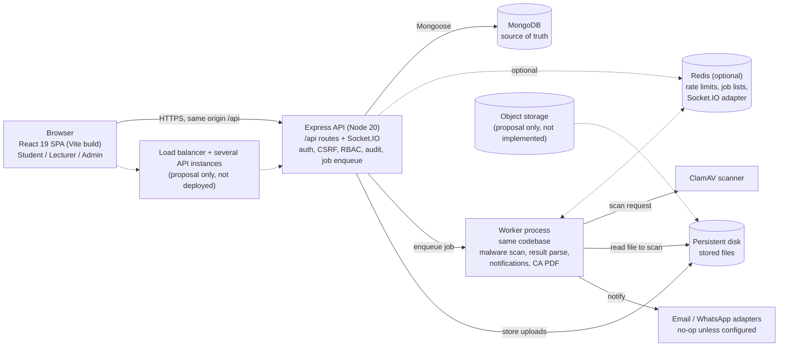
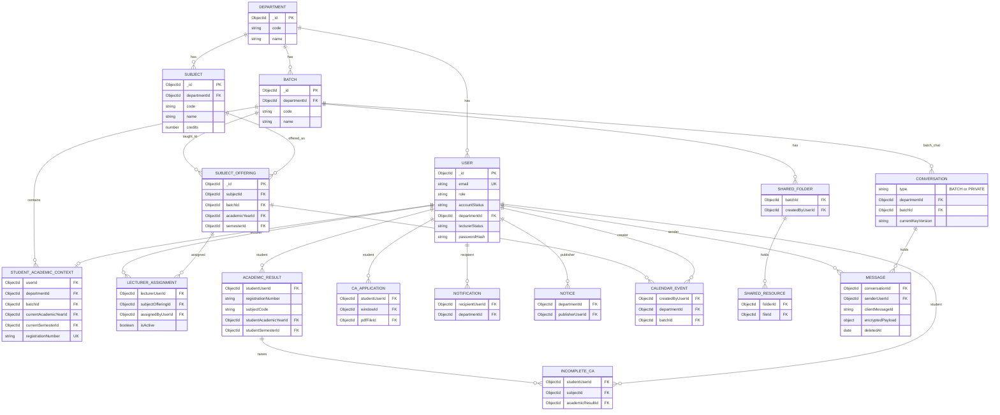

# SEU-AIMS

A Virtual Learning Environment / Learning Management System (VLE/LMS) for **one university department**, designed to grow later. It is not a CA-only app: CA Recovery is one module inside the platform.

**Architecture:** a MERN **modular monolith**. One Express API, one React app, and worker processes that run from the same codebase. It is not microservices.

## Project details

| Item | Value |
|---|---|
| Course | SWT22022, Practical for Internet Application Development, South Eastern University of Sri Lanka |
| Repository | https://github.com/abdullllbasith/SEU-AIMS |
| Live deployment | https://seu-aims.onrender.com (confirm before submission) |
| Group ID / members | TODO: add group ID, member names and registration numbers |

## Stack

| Layer | Technology |
|---|---|
| Frontend | React 19, React Router 7, Vite 6 |
| API | Node.js 20, Express 4 |
| Data | MongoDB (source of truth) |
| Cache, jobs, sockets | Redis when connected |
| Realtime | Socket.IO (Study Room) |
| Files | Storage interface. `local_dev` locally; production refuses it |

## Architecture



Static image version: [docs/images/architecture.png](docs/images/architecture.png). On Render, one Docker web service serves the API, Socket.IO and the built frontend on one origin.

Request flow: the browser sends the session cookie (and a CSRF token on state-changing requests). Express middleware authenticates, checks role and department, validates input, then calls the module service. The service reads or writes MongoDB, writes an audit record where required, and returns a JSON envelope with a `data` field. Errors are typed (validation, not-found, conflict, forbidden).

## Database design (ER diagram)

Selected collections. The full list is in the Mongoose models under `backend/src/modules/*/models/`.



`ACADEMIC_RESULT` has a unique index on `registrationNumber + subjectCode`. `MESSAGE` stores ciphertext only. Static image version: [docs/images/er-diagram.png](docs/images/er-diagram.png).

## Roles

Only three roles exist: `STUDENT`, `LECTURER`, `DEPARTMENT_ADMINISTRATOR`. There is no HOD portal. The HOD's CA role is a physical signature, recorded by an administrator. Study Room is student-only.

Official results are matched by **registration number + subject code**, never by subject display name.

Backend authorization is authoritative. The UI is not a security boundary.

## Modules

Backend modules live in `backend/src/modules/`, and frontend pages in `frontend/src/modules/`.

| Module | Purpose |
|---|---|
| `authentication` | Login, sessions, CSRF, password reset, change own password, department administrator account management |
| `academic-foundation` | Departments, batches, years, semesters, subjects, offerings, lecturer assignments, student context |
| `results` | Official result import and identity rules |
| `gpa-cgpa` | GPA and CGPA calculation (DICT-SEUSL calculator snapshot) |
| `ca-recovery` | Continuous-assessment recovery applications, physical verification, review |
| `learning-environment` | Official learning resources per subject offering |
| `lecturer-workspace` | Lecturer views of assigned offerings |
| `student-experience` | Student profile, dashboard, and academic views |
| `study-room` | Student-only study room: batch common chat, private chat, shared files, moderation |
| `study-agent` | Study assistant |
| `staff-agent` | Assistant for lecturers and administrators |
| `notices-calendar` | Notices and calendar events |
| `notifications` | In-app notifications and delivery channels |
| `assessment` | Assessment and attempt handling |
| `files` | Storage, uploads, and malware-scan gating |
| `admin-operations` | Department-scoped operational dashboards and exports |
| `audit-security` | Audit log and operational integrity checks |

Module boundaries and ownership are documented in [docs/architecture/module-boundaries.md](docs/architecture/module-boundaries.md).

## Administrator features

Department administrators can:

- Manage students and lecturers: search, detail views, suspend and restore accounts, and set passwords.
- Manage other administrators from the **Administrators** page. They can create an administrator, suspend or restore one, and reset one's password. A new or reset password is generated and shown once.
- Run academic admin workflows, result imports, CA review, resource moderation, and Study Room shared-file moderation.

Safeguards for administrator management:

- Admins only manage accounts in their own department.
- An admin cannot suspend their own account, reset their own password from that page, or suspend the last active administrator in the department.
- Create, status change, and reset actions are written to the audit log, without password values.

Every signed-in user can change their own password on the **Profile** page.

## Prerequisites

- Node.js **20** (see `.nvmrc`)
- npm. Use `npm ci` with the committed `package-lock.json`.
- MongoDB for the local API. Tests use `mongodb-memory-server`, so a separate instance is not needed for tests.
- Redis, optionally. It provides shared rate limits, the job queue between API and worker, and the Socket.IO adapter.

## Setup

```bash
cd SEU-AIMS
cp .env.example .env          # Windows: copy .env.example .env
# Fill AUTH_JWT_SECRET and the local Mongo/Redis values. Never commit .env.
npm ci
```

If you run the API from `backend/`, copy the environment file there too. The templates contain no real secrets.

## Commands

| Purpose | Command |
|---|---|
| API (watch) | `npm run dev:api` |
| Worker (watch) | `npm run dev:worker` |
| Frontend (Vite, proxies `/api` to `:3001`) | `npm run dev:web` |
| All tests (backend and frontend) | `npm test` |
| Backend tests only | `npm run test:backend` |
| Frontend tests only | `npm run test:frontend` |
| Production frontend build | `npm run build` |
| Bundle leak check | `npm run check:bundle` |
| Secret pattern scan | `npm run check:secrets` |
| Doc link check | `npm run check:docs` |
| Full CI sequence | `npm run ci` |
| Production API / worker | `npm run start:api` / `npm run start:worker` |
| Local QA seed | `npm run seed` |

`npm run seed` creates synthetic QA departments, students, lecturers, and administrators for **local development only**. It refuses to run when `NODE_ENV=production`. It is not a production data loader.

Default local URLs: web `http://localhost:5173`, API `http://localhost:3001`. The frontend reads `VITE_API_BASE_URL`, which defaults to `/api` (same origin, through the Vite proxy).

## Deployment

Production runs the API and worker as separate processes. The frontend is built with `npm run build`. Production start refuses the `local_dev` file driver. See [docs/ops/deployment.md](docs/ops/deployment.md) and [docs/ops/environments.md](docs/ops/environments.md). Secret handling is in [docs/ops/secrets.md](docs/ops/secrets.md).

## Documentation

- [docs/README.md](docs/README.md): documentation index
- [docs/handbook.md](docs/handbook.md): operator and user handbook
- [docs/api/README.md](docs/api/README.md): API surface
- [docs/architecture/](docs/architecture/): architecture, data model, and job graph
- [docs/decisions/](docs/decisions/): architecture decision records
- [docs/development/](docs/development/): local setup, coding standards, environment reference
- [docs/qa/final-audit.md](docs/qa/final-audit.md): release audit record

The architecture pack in the parent folder (`Architecture/`) outside this repository is the product source of truth when it conflicts with older drafts.

## Known limitations

- **1000+ users** is a design target, not a measured load result.
- Object storage drivers other than `local_dev` are not implemented. Production start refuses `local_dev`, so file reads and writes fail closed until an adapter is added.
- Email, WhatsApp, and malware scanning are no-ops unless configured. A provider reporting "accepted" does not mean delivered.
- There is no transactional outbox. Redis job lists persist jobs only if Redis itself persists them.
- The Socket.IO Redis adapter is wired but not load-tested across multiple API instances.
- Administrators created or reset from the Administrators page are not forced to change their password at first sign-in. They are told to change it, but the app does not enforce it yet.
- Human UAT is not signed off. There is no browser-driven end-to-end test suite.
- GPA points and bands follow the DICT-SEUSL calculator snapshot in code. They are not checked against a senate gazette in this repository.
- Study Room student blocking is not implemented.

## Contributing

See [docs/development/contributing.md](docs/development/contributing.md). Do not add roles, give lecturers Study Room access, or change result identity without an explicit project decision. See the [decision records](docs/decisions/).
