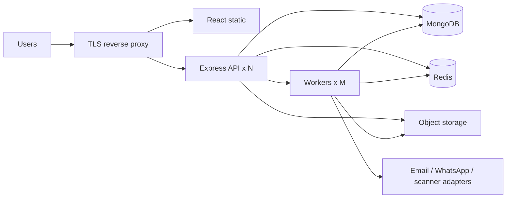
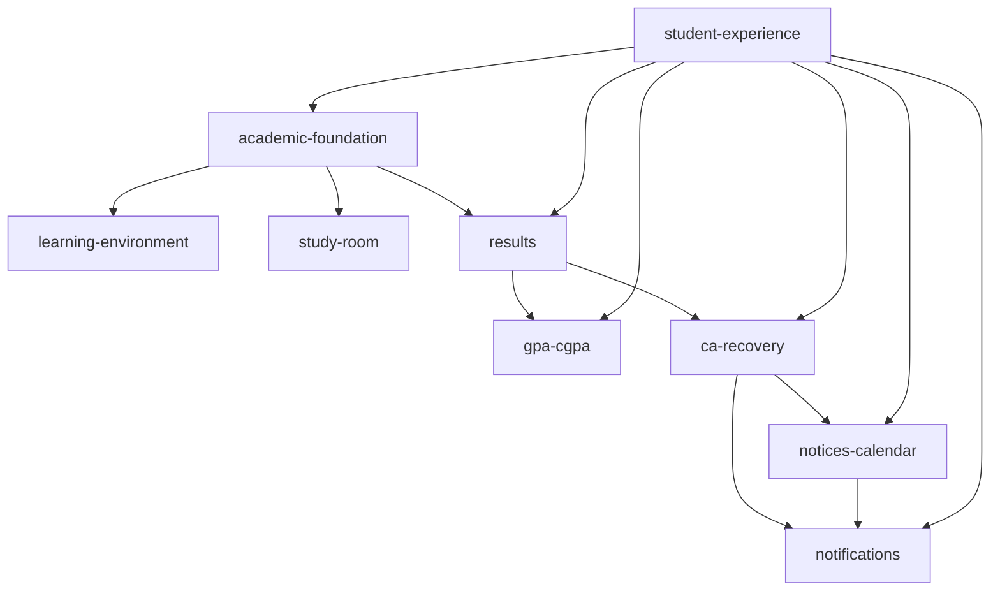
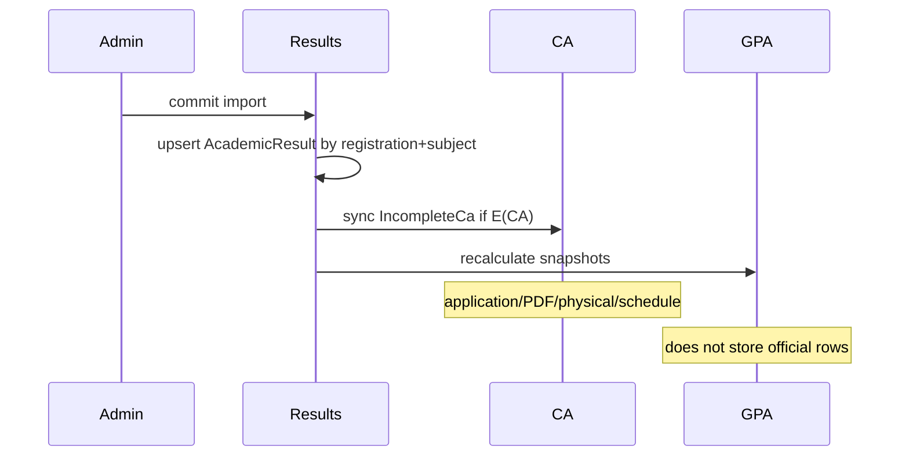

# Diagrams

Source is Markdown/Mermaid in git (not a binary-only image).

## Runtime

## Academic ownership

## Result → CA → GPA

CA schedule times live on CA; `CalendarEvent` is a representation with `sourceModule` / source id.
